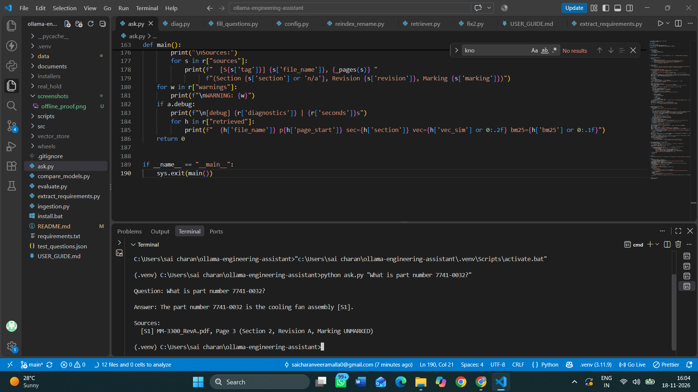
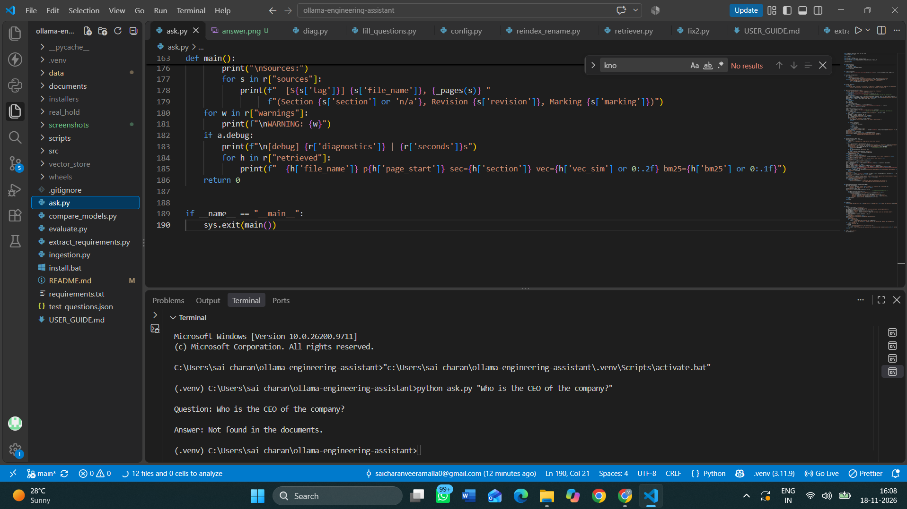
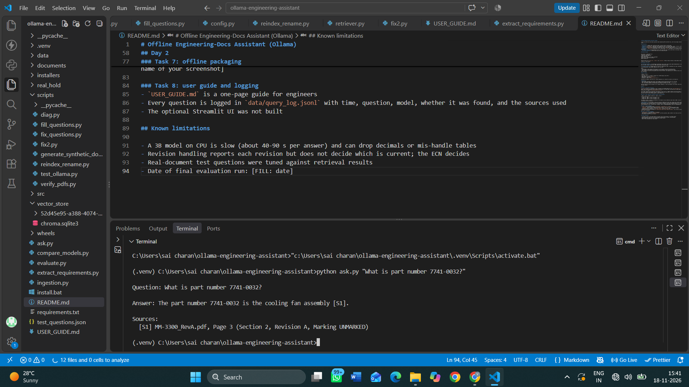

# Offline Engineering-Docs Assistant (Ollama)

A fully local RAG tool that answers questions about engineering PDFs and DOCX files, with file and page citations. It needs no internet after setup.

Repository: https://github.com/Vsaicharan012/offline-engineering-docs-assistant

## Screenshots

**Answer with source citation**



**Question not in the documents**



**Working with Wi-Fi switched off**



## Architecture

- **Extraction:** PyMuPDF (PDF), python-docx (DOCX), Tesseract OCR for scanned pages
- **Chunking:** section-aware, tables kept whole, metadata per chunk (file, page range, section, revision, marking)
- **Index:** `nomic-embed-text` embeddings in ChromaDB (persistent), plus BM25 keyword search
- **Retrieval:** hybrid ranking with Reciprocal Rank Fusion, plus an exact-term boost and per-revision retrieval
- **Answering:** `llama3.2:3b` through Ollama, strict system prompt, `[S#]` tags mapped to file and page from metadata (the model never writes page numbers)
- **Not-found logic:** a score gate before the LLM, then the prompt rules, then a post-check on the answer text
- **Incremental ingestion:** SHA-256 hashes skip files already processed

## Setup and usage

```
pip install -r requirements.txt
ollama pull llama3.2:3b
ollama pull nomic-embed-text
python ingestion.py
python ask.py "What is part number 7741-0032?"
python ask.py --debug "your question"
python evaluate.py
```

Prerequisites: Python 3.11, Ollama, and Tesseract OCR (Windows build from UB Mannheim).

Offline install: `install.bat` installs from a local `wheels/` folder. The `wheels/` and `installers/` folders (Python, Ollama and Tesseract installers, and a copy of the Ollama models folder) are not in this repository because of their size. Create `wheels/` with `pip download -r requirements.txt -d wheels` on an online machine. `install.bat` has not been tested on a clean machine.

## Test hardware

This was built and measured on an **8 GB RAM laptop** (mostly CPU), not the 16 GB the assignment assumes. That is why a 3B model was used and why answers take roughly 40-90 seconds.

## Documents (14 total)

**7 real public documents:** MIL-STD-882E, MIL-STD-461H, FAA AC 43-6D, FAA AC 43-9D, NASA SP-2016-6105 Rev 2 (Systems Engineering Handbook), NASA TN D-6646 (thermal vacuum test), DRDO radome design optimisation paper.

**7 synthetic documents:** EQ-SPEC-1001 Rev A and Rev B, ECN-2025-014 (DOCX), TR-2025-031 test report, MM-3300 maintenance manual, ICD-5001 (marked RESTRICTED), SCAN-TM-0001 (image-only PDF, tests OCR).

Notes:
- MIL-STD-461H is used instead of 461G because it is the current revision and supersedes 461G.
- MIL-STD-810H was downloaded but not ingested, because embedding it was too slow on this laptop.
- The assignment asks for 8 or more real documents and 15 or more in total. This submission has 7 real and 14 total, because the extra FAA download was unavailable.

## Day 1 results

| Measure | Result |
|---|---|
| Chat model speed | 4.1 tokens/s (llama3.2:3b, 8 GB RAM laptop, mostly CPU) |
| Model memory | 2.9 GB (`ollama ps`) |
| Index size | 1,684 chunks |
| Evaluation | 16/20 (`data/eval_results.csv`) |

Evaluation by category: exact-term 3/3, revision comparison 2/2, factual 6/8, table 3/4, not-found 2/3.

The 20 test questions are in `test_questions.json`.

**Failures:**
- q07 and q08: the answers were correct, but the page in the test file did not match the cited page.
- q10: the 3B model dropped the decimal point (reported 40 kg instead of 4.0 kg).
- q19: the 3B model answered a not-found question instead of returning "Not found in the documents."

Some test questions name the document ID (for example "MM-3300") or reuse the document's own wording. Those choices came from tuning on the retrieval results.

## Day 2

### Task 5: requirements extraction
`extract_requirements.py` extracted 24 "shall" statements from EQ-SPEC-1001 Rev B into `data/requirements.csv` (ID, text, type, section, page). IDs, sections and pages come from regex on the PDF text. The type comes from Ollama with a JSON schema, validated by Pydantic, with one retry and errors logged to `data/requirements_errors.log`.

The 3B model labelled every requirement "performance" on the first run. I added a keyword rule that overrides a "performance" label when the text clearly matches environmental, safety or interface terms. The final split is a mix of all four types, but the classification is a heuristic and has not been checked against a human-labelled set.

### Task 6: model comparison (4-question sample, 8 GB CPU laptop)

| Model | num_ctx | Memory (ollama ps) | Speed | Correct |
|---|---|---|---|---|
| llama3.2:3b | 4096 | 2.9 GB | 45 s/answer | 4/4 |
| llama3.2:1b | 4096 | 1.8 GB | 40 s/answer | 1/4 |
| llama3.2:3b | 2048 | 2.7 GB | 91 s/answer | 3/4 |

The assignment asks for all 20 questions; only 4 were run because of laptop speed and the deadline, so treat the result as indicative. The 3b model at num_ctx 2048 was slower than at 4096. I did not investigate why, and other running apps may have affected it.

**Recommendation:** on this laptop, llama3.2:3b with num_ctx 4096 was the best setup, because the 1b model saved little time and got far fewer answers right. For a client GPU server I would recommend a 7-8B model at q4_K_M (for example qwen2.5:7b), because the 3B model drops decimals and sometimes answers not-found questions. I would use num_ctx 8192 so more chunks and both revisions fit, and OLLAMA_NUM_PARALLEL of 2-4 for several engineers at once. I did not test a 7B model, a GPU, or OLLAMA_NUM_PARALLEL; these are recommendations, not measurements.

### Task 7: offline packaging
- `install.bat` creates the venv, installs from `wheels/` with `--no-index`, and sets telemetry variables
- `wheels/` and `installers/` are created locally (see Setup) and not committed
- ChromaDB telemetry is disabled in `src/vector_store.py`; Streamlit is not used
- Offline proof: with Wi-Fi switched off, `python ask.py "What is part number 7741-0032?"` still returns an answer (see `screenshots/offline_proof.png`)

### Task 8: user guide and logging
- `USER_GUIDE.md` is a one-page guide for engineers
- Every question is logged in `data/query_log.jsonl` with time, question, model, whether it was found, and the sources used
- The optional Streamlit UI was not built

## Known limitations

- A 3B model on CPU is slow (about 40-90 s per answer) and can drop decimals or mis-handle tables
- Occasionally the model gives an answer without a valid citation tag; the app prints a warning
- Revision handling reports each revision but does not decide which is current; the ECN decides
- Real-document test questions were tuned against retrieval results
- Final evaluation run: 2026-11-18